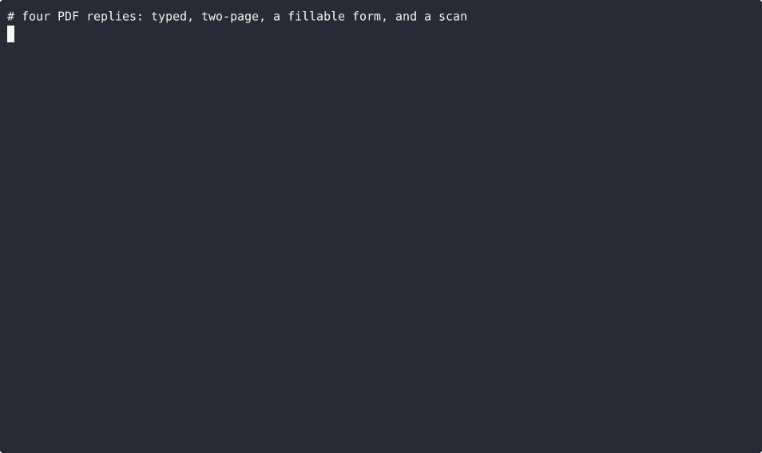

# pdfrows



You have a folder of PDFs. Survey replies, intake forms, applications. You want one spreadsheet with a row per file.

```
pdfrows ./replies --spec fields.json --out rows.csv
```

## The spec

```json
{"fields": [
 {"name": "name", "labels": ["Name"], "form_names": ["full_name"]},
 {"name": "email", "labels": ["Email"], "pattern": "[^@\\s]+@[^@\\s]+\\.[a-z]{2,}"},
 {"name": "comments", "labels": ["Q2. Comments"], "multiline": true}
]}
```

If the PDF is a fillable form, the value comes straight from the field named in `form_names`. Nothing is guessed.

If it's a typed or flattened PDF, the value is whatever follows the label, on the same line or the next. A label has to start its line and match the way it's written, so "Name" doesn't grab a sentence like "enter the owner's name on line 1". `multiline` keeps reading until the next label.

`pattern` checks the value. A value that fails is kept as written and listed under `invalid`, not thrown away.

## What every row tells you

Each value has a `_source` column (`form` or `page 2`), so you can check it.

`missing` names the fields that weren't found.

`status` is one of these:

| status | meaning |
|---|---|
| ok | everything found |
| partial | some fields missing or invalid, see the columns |
| needs_ocr | no text in it at all, it's a scan |
| encrypted | password protected, not opened |
| unreadable | broken file |

On a fillable form, an empty field is reported as empty. The printed instructions next to it are never read as the answer. (Tried on a blank IRS W-9 before that rule existed, it returned "An entry is required" as someone's name.)

## Tables

Some PDFs don't hold answers, they hold tables. Price lists, order lists, statements, reports. For those:

```
pdftables ./pdfs --out tables.csv
```

Every table from every file lands in one sheet, in file order and page order. Each table keeps its own header row and there is one blank row between tables. File names sort by number, so `9.pdf` comes before `10.pdf`.

A second file, `tables_report.csv`, has a line for each table: which file and pages it came from, which rows of the sheet it sits in, and what was checked.

What it checks and tells you:

| it says | meaning |
|---|---|
| found by ruled lines | the table has drawn lines, the cells follow them |
| found by spacing | no lines, the columns were read from the gaps. Look at these first |
| runs over pages | the same header came back on the next page, so it was joined into one table |
| total adds up | a row called Total or Subtotal was added up again from the rows above it and it matches |
| the table says X, the rows above add to Y | it doesn't match. The number is left as printed, never corrected |
| total not checked | a cell above it isn't a plain number, like `R7.737` for a revised figure |
| looks scanned | the page has no text in it, nothing was read |
| characters in no table | how much text on the page ended up outside every table. A big number can mean a table was missed |

`--source-columns` puts the file name and page in front of every row. `--strict` exits 1 if any file had a problem or any total didn't add up.

Tried on real files, not only the test ones. On the EIA monthly energy table (67 rows, 13 columns, no ruled lines) the 25 printed totals that could be checked all matched the sum of the rows read above them. On two pages of the IRS 1040 tax table, 298 of 299 rows in the 10% bracket matched the tax worked out by hand from the row's own income range, and the one that didn't is the row where the 12% bracket starts.

What it does not do well yet: pages where a table sits beside columns of ordinary text (some IRS worksheets came out in pieces), and tables whose cells wrap onto several lines without ruled lines between the rows. The report marks spacing finds so you know where to look.

## Tests

`./check.sh` builds its own test PDFs: typed, two-page, fillable, blank fillable with printed instructions, scanned, password locked, broken, and one where the label word shows up inside a sentence. Then it runs 13 tests on them, and 19 more on tables: ruled, unruled, running over three pages, a wrong total, stacked cells, two columns of plain text that must not become a table.

Also checked by hand on the real IRS W-9, blank and with a field filled in.
